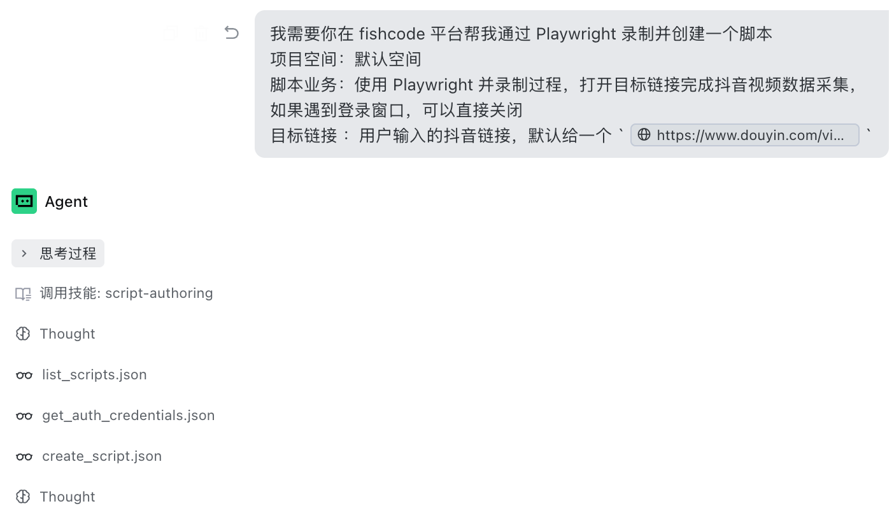
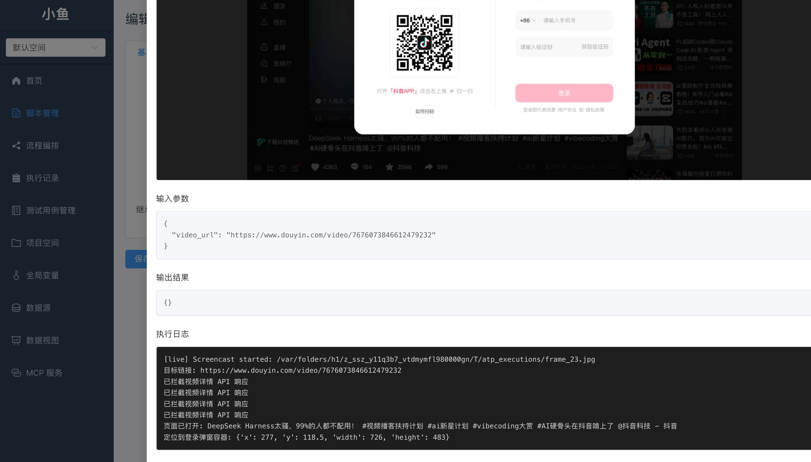
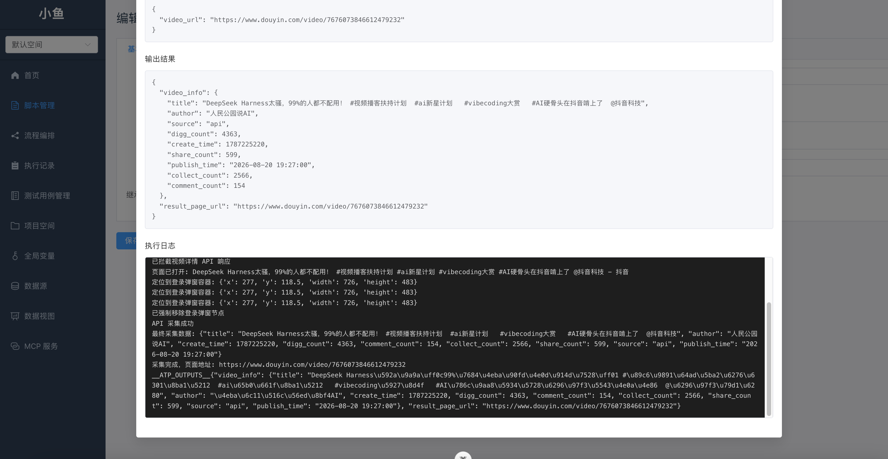
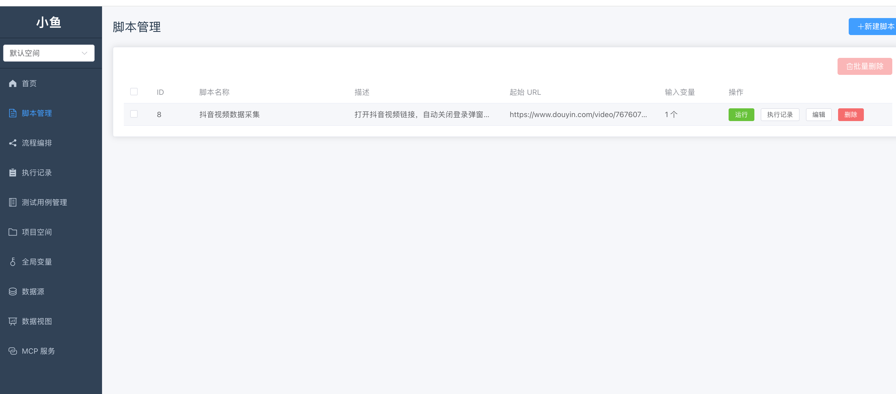

# 小鱼（fishCode）

小鱼：本地运行的自动化测试与数据采集平台。编写 Playwright Python 脚本、可视化编排流程、执行并查看实时日志；配套数据源管理、数据视图（SQL 对外取数）、测试用例管理，并内嵌 MCP 服务与 AI 助手，让智能体直接操作平台。

## 功能特性

- **脚本管理**：Monaco 编辑器编写 Playwright Python 脚本，支持参数化输入/输出定义、手动与 mock 两种运行模式，一键运行并实时查看日志与结果
- **流程编排**：Vue Flow 画布拖拽编排多个脚本节点，按拓扑顺序执行，节点间通过 `{{global.xxx}}`、`{{node_xxx.xxx}}` 模板语法传递变量
- **执行监控**：执行记录实时日志（WebSocket 推送）、最终状态与输出结果，支持批量删除
- **全局变量**：header / cookie / localStorage / variable 四类凭证与变量，按域名匹配自动注入脚本执行环境
- **测试用例管理**：项目空间 → 需求 → 模块三级组织，单条/批量状态维护，Markdown 结构化导入，思维导图预览
- **数据源与数据视图**：MySQL 等数据源连接管理与 SQL 工作台（只读/执行、执行历史）；数据视图以只读 SQL 对外提供无鉴权 JSON 取数接口（`GET /api/data/{slug}`）
- **MCP 服务**：平台能力封装为 MCP 工具（脚本/执行/数据源查询等），供 Claude Code、Trae 等 AI 客户端调用

## 界面预览

### 导入 MCP 和 Skills 后，使用 AI 创作脚本

输入你需要创作的脚本提示词



### 脚本编辑与实时执行

一键运行并实时查看日志与结果：










## 技术栈

| 层 | 技术 |
|---|---|
| 后端 | Python 3.13（全 async）、FastAPI、SQLAlchemy 2.0 异步 ORM、MySQL 8（aiomysql）、Playwright、MCP |
| 前端 | Vue 3（`<script setup>` + TypeScript）、Element Plus、Pinia、Vue Flow（流程画布）、Monaco（代码/SQL 编辑）、markmap（思维导图） |

前后端分离的本地单用户架构，开发时由 Vite 代理 `/api`、`/storage`、`/mcp` 到后端。

## 快速开始

### 后端（端口 8000）

```bash
cd backend
python3 -m venv venv
source venv/bin/activate
pip install -r requirements.txt
playwright install chromium        # 首次需要

# MySQL 8 前置：建库（表由 DDL 或 init_db 自动创建）
mysql -uroot -p -e "CREATE DATABASE IF NOT EXISTS fishcode DEFAULT CHARACTER SET utf8mb4 COLLATE utf8mb4_unicode_ci;"
mysql -uroot -p fishcode < mysql_ddl.sql   # 规范建表 DDL；不执行则启动时 init_db 自动建表
cp .env.example .env                       # 按需修改 DATABASE_URL

uvicorn app.main:app --reload --port 8000
```

验证：`curl http://127.0.0.1:8000/api/health` → `{"status":"ok"}`

> DSN 必须带驱动后缀 `+aiomysql`，裸 `mysql://` 会去加载未安装的 MySQLdb 而报错。

### 前端（端口 5173）

```bash
cd frontend
npm install
npm run dev
```

浏览器访问 `http://localhost:5173`。

## 页面一览

| 路由 | 说明 |
|---|---|
| `/` | 首页概览 |
| `/scripts` | 脚本管理（编辑、运行、实时日志） |
| `/flows` | 流程编排（画布） |
| `/executions` | 执行记录 |
| `/test-cases` | 测试用例管理 |
| `/workspaces` | 项目空间 |
| `/global-variables` | 全局变量 |
| `/datasources` | 数据源管理与 SQL 工作台 |
| `/data-views` | 数据视图（对外取数） |
| `/agent` | AI 助手（trae-cli 内嵌对话） |
| `/mcp` | MCP 服务状态与接入说明 |

## AI 助手与 MCP

平台内嵌 MCP 服务（端点 `/mcp`），将脚本、执行、项目空间、数据源查询等能力封装为工具；配套三个 Agent Skills（脚本编写/执行/维护）提供操作指引。

AI 助手页面（`/agent`）可一键完成接入：注册平台 MCP 到 trae-cli + 安装 Skills。之后在页面内直接对话，智能体即可查询脚本、运行测试、取数等；访问令牌在接入状态卡片中配置。

## 目录结构

```
├── AGENTS.md              # 架构指引（给 AI 与新成员的开发文档）
├── backend/               # FastAPI 后端（详见 backend/README.md）
│   ├── app/
│   │   ├── routers/       # HTTP 入口（薄层）
│   │   ├── services/      # 业务逻辑
│   │   ├── models/        # SQLAlchemy 模型（列注释 + bigint unsigned 主键）
│   │   ├── schemas/       # Pydantic 出入参
│   │   ├── engine/        # 脚本执行引擎
│   │   ├── mcp/           # MCP 服务端
│   │   └── agent_skills/  # Agent Skills 文档
│   ├── mysql_ddl.sql      # MySQL 建表 DDL（由 scripts/gen_mysql_ddl.py 生成）
│   ├── scripts/           # gen_mysql_ddl.py（DDL 生成）、migrate_sqlite_to_mysql.py（SQLite 存量迁移）
│   └── storage/           # 附件存储（历史 SQLite app.db 已不再使用）
└── frontend/              # Vue 3 前端（详见 frontend/README.md）
    └── src/
        ├── api/           # Axios 封装
        ├── types/         # TS 接口
        ├── stores/        # Pinia store
        ├── views/         # 页面
        └── components/    # 复用组件
```

## 常用命令

```bash
# 后端
uvicorn app.main:app --reload --port 8000    # 开发
pytest tests/                                 # 测试

# 前端
npm run dev          # 开发热重载
npm run build        # 类型检查 + 构建
npm run type-check   # 仅类型检查
npm run test:unit    # vitest
```

## 安全说明

- 脚本以子进程执行任意 Python，仅适用于**本地单用户**场景，勿暴露到公网
- 数据源密码不明文回传；数据视图与 MCP 查询仅允许只读语句白名单
- CORS 仅允许本机前端地址

更多架构细节与开发约定见 [AGENTS.md](./AGENTS.md)。
